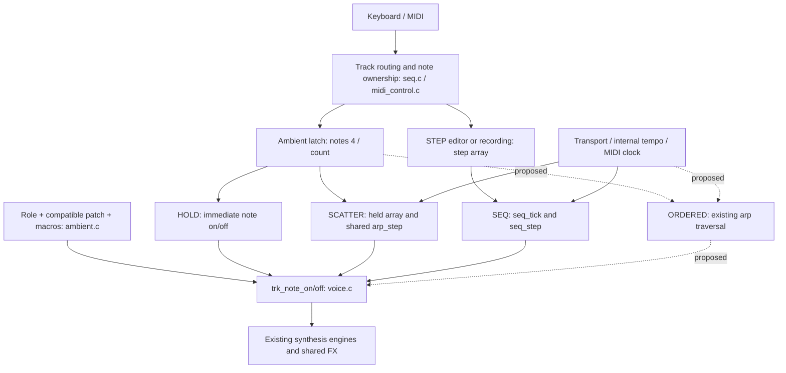

# PULSE: motif and controlled evolution assessment

2026-10-20. **Proposal only; implementation awaits review.**

## 1. Executive summary

Revised after user discussion: expose **ORDERED** as an opinionated configuration
of Felucca's existing arp. Do not build a new motif algorithm. HOME + ARP should
cycle **HOLD → ORDERED → SCATTER → SEQ**. ORDERED latches up to four unique
pitches in entry order, repeats in one octave, and plays every tick. Keep
HOME + SELECT for rate and the four HOME macros for sound. Preserve selected
notes when switching directly between ORDERED and SCATTER.

Keep existing global PLAY/STOP and external-clock behavior for this experiment.
Defer local run state, a new playback page, VAR, custom rests/repeats, timing
drift and octave variation until listening establishes a specific unmet need.
Felucca's existing arp pages remain the place for deeper adjustments.

The user found Felucca's HOLD control and confirmed that the existing arp is
capable of the desired basic behavior. The design opportunity is immediate
access with useful defaults, rather than another scheduling implementation.
This revision replaces the earlier MOTIF/local-transport proposal. It updates
the assessment only; firmware implementation has not started.

The reported SEQ problem is not evidence that its scheduler is missing: SEQ
plays `track_t.step[]`, not the latched SCATTER pool. Selecting SEQ clears that
pool. HOME taps in SEQ audition notes; writing the phrase requires the STEP
editor. This interaction differs fundamentally from the requested motif.

This assessment is compatible with the pending product direction, but future
code changes have shared-file integration risks. No firmware, branches, presets,
hardware or independent Sound Bath repository were changed during this task.

## 2. Integration baseline

Drone, role/sound separation, factory auditions and Sound Bath are consolidated
in the current development source. ORDERED remains a proposal. Keep Drone's
HOLD-only policy, factory envelopes, Tide experiments, Sound Bath PHYS controls,
patch IDs and storage compatibility intact when implementing it. Scheduling and
mode handling share `ambient.c`, `seq.c`, MIDI and UI paths, so the implementation
must be tested against the combined source rather than an older isolated branch.
No new DSP, factory patch rewrite or independent Sound Bath repository change
is needed. Earlier local handoffs and repository inventories remain local.

## 3. Current architecture and PULSE behavior

`firmware/src/seq.c` defines `ambient_layer_t`: independent `role`, `patch`,
`mode`, macro values, four selected notes and timing metadata per track.
`ambient.c:ambient_patch_find` implements a small allowed-pair catalog, not a
general engine capability adapter. Four tracks share eight voices.

PULSE patches are WARM PLUCK, SOFT MALLET and BELL PLUCK (PHASE), plus GLASS BELL,
FM MARIMBA and FM TINE EP (factory FM6). `ambient_patch_apply` selects the sound;
`ambient_mode_apply` configures playback without replacing the stored pattern.
PULSE defaults to SCATTER on track 3; it is not intrinsically a random scheduler.
It can also use HOLD or SEQ, on any track.

### Selected notes and order

`ambient_pulse_toggle` toggles up to four latched pitches, driving the keyboard
selection display through existing latch state. It appends additions, but removes
by swapping in the last note: `notes[]` therefore does not always retain entry
order. The arp's separate `track_t.held[16]` appends unique pitches in `arp_add`
and compacts removals in `arp_remove`, preserving survivor order. MIDI ownership
can make these two lists differ; do not assume either is a complete combined
keyboard/MIDI selection model.

`arp_step` already copies this list, optionally sorts it when `P_AORDER == 0`,
expands octaves, and selects a traversal. Random mode 4 ignores entry order for
pitch choice. Generic ordered traversal exists; it is not exposed as an ambient
ORDERED configuration. Duplicate note-on does not add a duplicate arp position.

## 4. HOLD, SCATTER and SEQ

| Mode | Input and sound | Scheduling / activation |
| --- | --- | --- |
| HOLD | Keyboard taps toggle immediate sustained notes. Tide/Pulse up to four, Texture one register, Cloud three pitches in current source. Envelopes still determine whether a sound actually sustains. MIDI has separate ownership semantics. | No PLAY required. Stored sequence is suppressed. Drone is forced to HOLD and uses gesture-based chord replacement instead of toggles. |
| SCATTER | Keyboard toggles up to four selected pitches; generator chooses randomly from arp held notes. Other compatible roles can use it too. | `P_AMODE=4`; shared `arp_step`; ambient dispatch requires `song.playing`. Gate and probability govern events. Stored sequence is suppressed. |
| SEQ | Uses written `step[]`; keyboard input is momentary audition/step entry rather than ambient latch. Pattern supports notes/chords, rests, ties and existing sequencing features. | `seq_tick` requires PLAY and ambient `AM_SEQUENCE`. `seq_step` triggers written material. No automatic conversion from a selected chord. |

`ui_input.c:ui_frame` handles HOME + ARP, cycling three modes, and SEQ tap from
curated HOME selects SEQUENCE and opens STEP at cursor 0. `seq_entry` writes
pressed notes to the current step and advances when all keys are released.
`ambient_mode_set` clears local live notes/MIDI ownership, retains written
patterns, and initializes an empty default-length sequence to eight half-note
steps. Patch/role changes retain mode, pattern, mix and timing choices while
clearing live notes and resetting macros.

### SEQ diagnosis and evidence limits

`tests/playing_modes_test.c` explicitly covers physical CLOUD step entry,
written pitch order, STOP, mode/pattern preservation and suppression of patterns
in HOLD. Browser checks in `web/emu/emu_test.mjs` also cover phrase entry. Those
are existing source checks and recorded historical validation, not tests rerun
for this assessment.

A likely reproduction of the reported failure is: select SCATTER notes, change
to SEQ, return HOME, press PLAY. The notes were cleared and no steps were written,
so an empty pattern is silent. This is a workflow mismatch, not a verified
scheduler defect. If a written pattern is silent, check track/mode, step contents
and length, mute/level, gate/envelope, voice pressure, and external clock receipt.
The exact hardware report remains unverified; do not label all SEQ failures solved.

## 5. Why PLAY is required

`seq.c:events_block` explicitly prevents ambient arp execution unless the track
is SCATTER **and** `song.playing`. `ambient_pulse_transport` resets the arp phase
on start and releases generated gates on stop. `seq_tick` separately gates written
patterns on the same transport. Internal time uses rendered sample increments;
external MIDI clock uses `midi_clock_advance`, with a 500 ms missing-clock stop.
This is shared ambient playback policy layered on inherited Felucca transport,
not a PHASE/FM synthesis requirement or uniquely PULSE-specific defect.

HOLD directly calls note-on through latch handling. Drone intentionally runs
independently of transport. Automatically calling `seq_start` on note selection
would also restart other tracks, chain state, automation and other clocked
features (`seq_start`, `seq_stop`): do not do that.

## 6. Current PULSE macros

| Macro | Original PHASE plucks | Factory FM6 Pulse patches |
| --- | --- | --- |
| SHAPE | `ambient_shape_turn`: PHASE depth `P_E2`, envelope depth `P_E3`, and attack/decay/release; sustain fixed zero. Changes timbre and articulation, not motif order. | Locked FACTORY TONE. |
| MOTION | `ambient_motion_apply`: per-note RAND matrix to shape (0–28), amplitude (0–32), pan (0–18). No pitch/order/rate variation. | Locked FACTORY TONE. |
| DENSITY | `ambient_density_apply`: hit probability `3 + density*124/100`, accepted on `rng & 127 <= probability`. SCATTER ranges from 4/128 to all ticks. Outside SCATTER also adds PHASE detune 0–12 and chorus 0–60. | Writes probability only; no timbre rewrite. |
| SPACE | `ambient_space_apply`: delay/reverb sends and dry balance; shared buses. | Scales existing factory spatial sends; 50 restores source sends and unity dry; zero removes sends. |

DENSITY's probability affects arp scheduling, not SEQ's note chance. At DENSITY=0
SCATTER is sparse, not silent. `ambient_density_apply` sets PHASE arp gate to
32/128 of the interval. Factory patches also receive that default in
`ambient_mode_apply`, but keep source envelopes. Cloud already has separate
SHORT/FLOW/LONG clocked articulation policy.

Rate is already separate: HOME + SELECT in `ambient_pulse_speed_turn` chooses
1/2, 1/4, 1/8, 1/16; it updates arp rate for SCATTER and actual `P_SDIV` for SEQ.
These are tempo divisions, not independent millisecond intervals. At 120 BPM
half notes are one second apart; slower intervals need a bounded extension or
lower tempo. `arp_step` uses velocity 100 and current swing (ambient resets swing
to zero). Stochastic timbre/engine behavior means exact note events do not imply
bit-identical audio on each cycle.

## 7. Gap analysis

| Capability | Current implementation | Desired behavior | Gap | Recommended change |
| --- | --- | --- | --- | --- |
| Note selection | `ambient_pulse_toggle` provides four toggle pitches. | Select 2–4 notes easily. | Mode changes clear selection. | Preserve the pool on direct ORDERED/SCATTER transitions. |
| Note order | `arp_add/remove` preserve order; latch removal swaps; `arp_step` can sort. | Entry-order repetition. | Ordered arp is not exposed through ambient playing modes. | Use existing ascending traversal with `P_AORDER` set to as-played; compact latch removals. |
| Repetition | Existing arp already supports deterministic traversal. | Stable repeating phrase. | Ambient SCATTER selects random traversal. | Add ORDERED configuration, one octave and full hit probability by default. |
| Variation | Existing arp modes, probability, swing and octaves; sound MOTION. | Discover useful variation through listening. | No proven need for a custom algorithm. | Retain existing deeper arp controls; defer VAR and custom evolution. |
| Timing | Existing clock and four HOME divisions. | Slow to moderate pulse. | No new requirement established. | Reuse existing divisions and HOME + SELECT. |
| Silence/rests | `P_APROB` omits arp events. | Exact initial repetition; optional deeper experimentation. | Pulse density currently lowers probability. | Full probability for ORDERED by default; retain deeper arp probability control. |
| Playback activation | Global PLAY drives ambient SCATTER and SEQ. | Evaluate ordered repetition without changing transport. | Earlier proposal broadened scope. | Keep global PLAY/STOP and MIDI clock behavior. |
| Macro mappings | Sound macros with Pulse density also controlling probability. | Keep sound controls predictable. | ORDERED must not inherit density-driven omissions. | Use non-scatter PHASE sound width; factory Pulse density remains inactive for sound. |
| Per-layer reuse | Shared arp and role-specific envelope policy. | Reuse existing infrastructure. | New mode needs shared dispatch/eligibility checks. | Extend arp-mode predicates; keep Drone HOLD-only. |

These are principally access and integration gaps. No new traversal algorithm
is needed and no SEQ scheduler bug has been established. Felucca's `P_AHOLD`
already supports arp hold; AmbWave's tap-to-toggle latch is the intended ambient
interaction and must not be replaced by the generic hold/chord-replacement rule.

## 8. Recommended ORDERED behavior

Add an ambient mode named ORDERED. Append its enum value so existing mode numbers
remain stable, and use an explicit UI cycle HOLD → ORDERED → SCATTER → SEQ.
Audit `% 3`, range guards, mode-name arrays, emulator exports and undo consumers.

Configure the existing arp for forward traversal, as-played order, one octave,
zero swing and full hit probability. Reuse `arp_step` unchanged where possible;
no separate cursor, PRNG or motif scheduler is needed. Its existing index reset
selects the first note on transport start. Exact repetition refers to note events;
MOTION, source synthesis and effects can still evolve the sound.

Use up to four unique keyboard-selected pitches. Append additions, compact
removals, and append a re-added pitch. Repeated pitch positions such as D–D–A
are outside the initial toggle-list interaction. Simultaneous keyboard presses
use deterministic physical scan order; do not promise sub-scan timing accuracy.

Switching directly between ORDERED and SCATTER retains the selected pitches,
entry order, speed and global transport state. Release the outgoing generated
gate and reset traversal so the next eligible tick starts at the first pitch;
switching while stopped must remain silent. Preserve mode-change clearing for
other transitions and current sound-change clearing. Do not lose MIDI owners
while preserving the keyboard pool: test duplicates, sustain, release and routing
against existing ownership rules before reusing either note array as authority.

## 9. Recommended UX and transport

HOME + ARP cycles **HOLD → ORDERED → SCATTER → SEQ**. HOME shows the active mode;
HOME + SELECT adjusts the existing rate. Tap notes to latch, press PLAY, and
compare ORDERED with SCATTER without re-entering the notes. STOP releases the
generated gate and retains selection. Existing PLAY restarts from the beginning.

Keep SHAPE, MOTION, DENSITY and SPACE focused on their existing sound meanings.
In ORDERED, original Pulse PHASE density can retain its non-scatter detune/chorus
mapping, but must not lower arp probability. Factory Pulse density has no sound
mapping: indicate inactive/FACT rather than add a new timbre design in this task.
SCATTER retains its accepted density/probability behavior.

Keep the existing arp pages accessible for deeper experimentation. ORDERED is
a useful default configuration, not a lock preventing edits to arp order, gate,
probability or octave range. Defaults guarantee exact repetition; explicit deeper
edits can alter it. Avoid silently resetting those edits on unrelated macro turns.
Returning to a mode can reapply its documented defaults; retain selected notes
and rate on the direct ORDERED/SCATTER transition. Audit mode reapplication on
Cloud length edits so it does not unexpectedly discard deeper arp edits.

No new playback page or local RUN/PAUSE state. Extend current ambient arp dispatch
and start/stop handling to include ORDERED. Preserve internal tempo, MIDI
start/stop and missing-clock behavior. Selecting notes or changing mode must not
call `seq_start`, restart other tracks or change `song.playing`. Drone continues
sustaining through STOP. Activation consistency remains a separate listening and
UX question after this experiment.

## 10. Reuse and per-layer compatibility

Reuse `arp_step`, `arp_add/remove`, `arp_sounding/arp_off`, `div_samples`, existing
arp pages, keyboard LEDs and track-specific note ownership. Introduce a shared
"ambient arp mode" predicate for ORDERED and SCATTER; keep random-only policies
separate. Audit `ambient_mode_apply`, `ambient_mode_set`, `ambient_pulse_toggle`,
`ambient_latch_toggle`, `ambient_pulse_transport`, `events_block` and MIDI paths
for assumptions that SCATTER is the only mode using the arp.

The scheduling configuration is shared rather than Pulse-engine-specific.
Pulse is the first listening target. Existing compatible Tide/Texture/Cloud
paths must either support the shared mode with their existing articulation
policy or visibly reject it; no silent nonworking cycle entry. Cloud keeps its
length policy. Texture may produce register/timbre movement rather than melody.
Factory envelopes remain source-owned. Sound Bath's PHYS patches need separate
articulation listening before claiming suitability; preserve its integration
hooks. Drone remains HOLD-only and rejects mode changes as it does today.

## 11. Risks and backward compatibility

- Preserve existing mode numbers, patch IDs, written patterns and project/user
  preset formats. Ambient state remains runtime-only; scene recall is separate.
- Preserve current sound-change clearing; seamless patch switching is unrelated.
- Handle mute, clear, mode change, panic, undo, MIDI channel/route changes and
  transport stops without stuck gates, stale selection or unmatched note-offs.
- Audit state exports in `web/emu/felucca_web.c`, consumers in `index.html`, and
  curated undo in `ui.c`; do not serialize live ownership state accidentally.
- Four-part patterns and long releases share eight voices. Gate length is not an
  acoustic duration guarantee. Rate limits and target CPU/RAM remain requirements.
- Preserve SCATTER's random traversal and renders. Existing `arp_step` still
  consumes RNG for probability at full probability; do not refactor that shared
  behavior or add a private variation PRNG as part of ORDERED.
- Documentation-only work has no firmware build/test requirement. No tests were
  rerun and no new listening or hardware conclusions are claimed here.

## 12. Smallest practical implementation plan after review

1. Recheck the pending-work boundaries and establish an agreed integration
   baseline and topic branch without committing or overwriting unrelated work.
   Keep the unchanged-upstream baseline recorded in `AMBIENT_PLAN.md`.
2. Expose ORDERED as a configuration of the existing arp; update the mode cycle,
   dispatch, rate access, LEDs/state exports and undo handling. Preserve Drone's
   restriction and source envelopes. Add no DSP or storage changes.
3. Preserve selected notes and order on direct ORDERED/SCATTER transitions.
   Separate ORDERED's full-probability default from Pulse density while retaining
   access to deeper arp edits. Add no new variation control or playback page.
4. Verify D–A–F across repeated cycles, first pitch after PLAY, note removal and
   re-add, simultaneous/duplicate input, empty/full pools, stopped/running mode
   transitions, two independent tracks, MIDI ownership/pedal, mute, clear, undo,
   external clock loss and unchanged Drone/SEQ behavior. Check deeper arp access
   and ensure unrelated macro turns do not overwrite explicit arp edits.
5. Run `./build.sh` through the AmbWave macOS wrapper before firmware testing,
   then `sh tests/run_tests.sh` through the established environment. Require
   regression audio, storage compatibility, UI layouts, CPU/RAM guards and
   native/Wasm parity; retain unrelated golden hashes.
6. Listen to three ordered latched notes over Tide or Drone. Compare SCATTER with
   the same selection. Decide whether any additional variation is needed from
   that audition. Hardware flashing requires explicit approval in the current
   conversation; implementation and installation are separate steps.

### Explicit design answers

1. **Expose ORDERED using the existing arp.** Keep SEQ and SCATTER; defer the
   custom MOTIF algorithm.
2. **Keep PULSE as a role.** Its compatible sounds and shared playing modes
   already express the separation needed for this experiment.
3. **Keep PLAY/STOP unchanged for now.** Evaluate ordered repetition before
   redesigning activation.
4. **Keep the four macros for sound.** Retain HOME + SELECT rate access and
   existing deeper arp pages; no new playback page.
5. **Use an ordered unique toggle list.** Compact removals, append re-additions,
   preserve notes across ORDERED/SCATTER, and audit MIDI ownership.
6. **Use the arp's existing variation options first.** New bounded evolution
   requires a specific listening finding rather than an assumed need.
7. **Prove latched ordered repetition first.** Select D, A, F → PLAY → hear
   D–A–F repeat → switch to SCATTER and back without re-entering notes. No written
   sequencer steps, new scheduler, local transport or custom variation algorithm.
