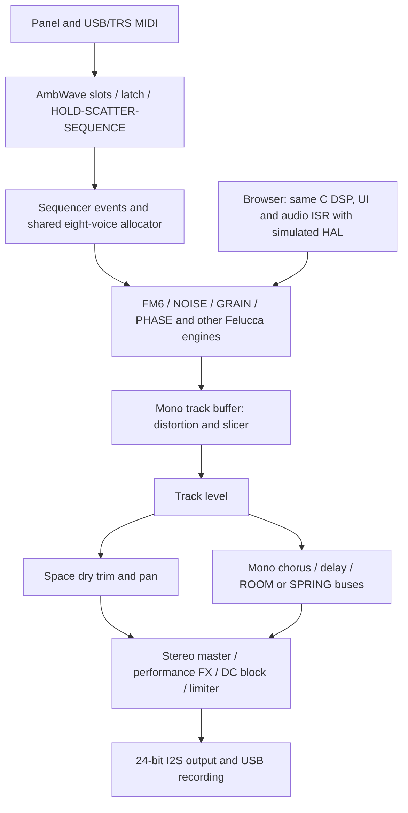
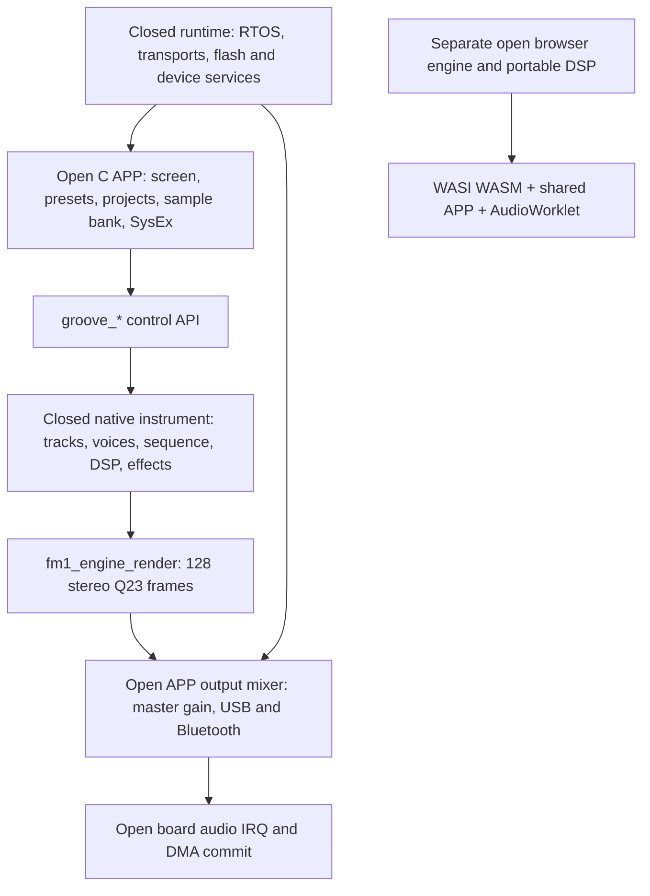
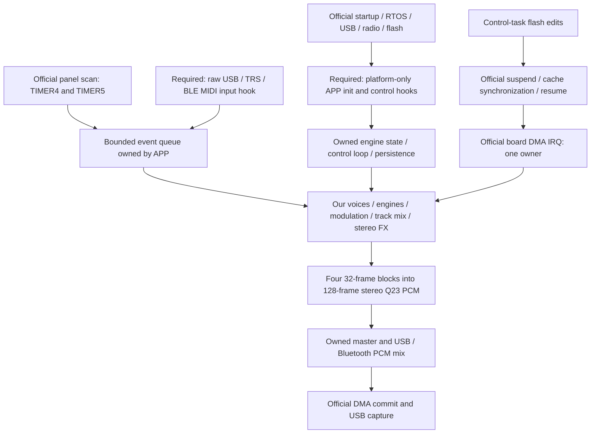

# FM1 Open SDK assessment for AmbWave

Assessment: **2026-10-18**. Recommendation: **retain Felucca; selectively evaluate open source and tooling ideas. Do not migrate to the binary SDK now.**

Critical follow-up: the [platform-services addendum](#addendum-our-dsp-on-official-platform-services) evaluates keeping our entire DSP architecture above the official services. It qualifies §4's bypass conclusion, extends strategy C, and supersedes §13's sound-experiment ordering.

## 1. Executive summary

**FM1 Open changes our options, but has not established a reason to change AmbWave's foundation.** Its most concrete additions are supported Bluetooth audio/BLE MIDI services, USB playback mixing, documented board interfaces, a larger shared user-sample allocation, and an integrated browser workbench. These are useful capabilities, but do not demonstrate richer pads, better granular synthesis, more usable RAM, greater measured polyphony, or better ambient reverb.

The important discovery is the boundary: the native SDK contains the instrument renderer, voice management, sequencer and effects, as well as platform services. The public application primarily supplies UI, storage, presets, transfers and board output. The browser includes a separate, open C implementation of the instrument and synthesis. **Open browser DSP is reusable source; the native library is not a modular DSP construction kit.** There is no public custom-engine registration interface, per-track audio tap, native FM instance API, or exposed native reverb processor.

AmbWave already has six-operator FM descended from the same MSFA/Dexed family, custom granular synthesis, multiple synthesis families, modulation, chorus, delay and two reverbs. Its immediate sound gaps are recipe/voice evolution, frequency cleanup, spatial routing and headroom. Switching platforms does not inherently fix these. Indeed, the documented official FM patch edits affect subsequent notes, whereas Tide already has live index and harmonic-weight paths for held notes.

Recommended strategy: **A now, with a bounded B research lane** (stay with Felucca; selectively study compatible open implementations). The addendum also recommends a bounded compatibility probe for hosting our own DSP on official services; this does not require the built-in track DSP APIs. C and D remain longer-term options only after the relevant lifecycle/access, licensing, performance and parity questions are resolved. Preserve four interchangeable sound slots, HOLD/SCATTER/SEQUENCE, and SHAPE/MOTION/DENSITY/SPACE.

### Evidence scope and reproducibility

| Item | Exact evidence |
| --- | --- |
| AmbWave inspected | `828ceaa3fd0b62e825820998e1a09ab90d6edcd1`, branch `codex/ambwave-mvp`; `ambient-prototype` is the same tip according to the existing assessment. Initial worktree also contained user changes to `AMBIENT_PLAN.md` and untracked `docs/DESIGN_GAP_ASSESSMENT.md`; both were read and left intact. |
| Official source inspected | **V13**, detached at `b178ac43c25f010c60a878056fb5331fe693fd62`, commit dated 2026-10-17. [Pinned source tree](https://github.com/m-vave/fm1_open/tree/b178ac43c25f010c60a878056fb5331fe693fd62). |
| Latest release distinction | GitHub releases/tags API returned **V12**, tag `3be7fbdbd3bb137bacbd65d68412c210eb977870`. The live workbench and current source serve/declare V13. This assessment uses the newer V13 kit, not only the older GitHub release. [Release listing](https://github.com/m-vave/fm1_open/releases), [live workbench](https://open.m-vave.com/fm1-workbench). |
| Live V13 development kit | [Official archive](https://open.m-vave.com/releases/V13/2a3b2ede16ac49c867831315714ef9d8c532c70ce28ce1dcf3fc76f0a9f68f57/FM1-Open-V13-Development-Kit.zip), 1,682,912 bytes; SHA-256 `2a3b2ede16ac49c867831315714ef9d8c532c70ce28ce1dcf3fc76f0a9f68f57`. All **150** tracked files matched the pinned checkout byte-for-byte, after normalizing ZIP backslash paths. |
| SDK verification | All **65** `sdk/manifest.json` payload hashes matched; native archive SHA-256 `6a22c111978c8f36827ca83b5f71828313bcb5a3464109b44754266d9bf55e09`. |
| Live browser verification | V13 WASM: 260,459 bytes, SHA-256 `d36d80f15c3452e33dff572bf60a2e54f749afe1b884fab55856e1f381cdf93a`. Recomputed the build script's 75-file browser-source fingerprint: `41ed2b3d635600d6fb3269295b355ba592c68efe3440990379b91abca86acda8`, matching the live metadata. |
| Live firmware metadata | Product `FM-1_8000013`, family 7, package 479,796 bytes, SHA-256 `c35330f1cad641f38908a6269c7316fdaf4ffb8b1091a7b3282fa31b9be9fe74`; metadata says `hardware_validated: false`. Read metadata only; did not download/install that package or independently validate hardware. |
| Local investigation | Separate official checkout `/private/tmp/ambwave-fm1-open-assessment`; downloads, harness and logs `/private/tmp/ambwave-fm1-open-evidence`. Temporary evidence is not a permanent project dependency. Reproducible smoke procedure is in §13. |

Labels used below: **Confirmed advantage**, **Possible advantage requiring testing**, **Equivalent capability**, **Regression or limitation**, **Unknown**. “Confirmed” means source/API/artifact inspection or the explicitly described host experiment; it does not imply listening approval or hardware validation. Inferences are identified explicitly.

The supplied [announcement URL](https://forum.m-vave.com/topic/4) returned only the forum application shell through the available read paths; its announcement text/date were not independently verified. The [Synth Anatomy article](https://synthanatomy.com/2026/10/m-vave-fm-1-open-the-green-light-for-custom-firmware-and-community-hacks.html) is dated October 17. Technical conclusions below come from the pinned sources, SDK metadata and verified workbench assets, rather than article descriptions.

## 2. What M-VAVE actually released

V13 is an eight-track instrument with six selectable source families: DX7/FM, 303, 808, PSG, pluck and sampler; eight shared sample pads/slots; 64-step patterns; projects and factory demonstrations. “16 FX demos” in the README is not evidence of 16 independently available effect algorithms. The public effects controls expose reverb decay, delay time/feedback and return level. See [O-instrument], [O-fx], [O-presets].

| Released material | What is actually available / replaceable |
| --- | --- |
| `app/` | C application source: `screen.c`, `presets.c`, `project.c`, `samples.c`, `transfer.c`, `audio_output.c`, board adapters. These can be modified/rebuilt. |
| `app/board/` | Panel, GPIO, LCD and I2S/DMA output source. Low-level device/RTOS/transport services remain in the library. This is a documented board, not a portable HAL for arbitrary hardware. |
| `sdk/include/`, `app/instrument.h`, `app/synth/` | Public contracts for complete-instrument control, rendering, transport, storage, tuning and sample binding. The presence of synthesis names in build checks does not make all those functions a supported external API. |
| `sdk/lib/libfm1_engine.a` | Native ELF32 PI32v2 binary: instrument plus platform. Source for native scheduling, rendering policy, optimized kernels and platform internals is not supplied. |
| `web/engine/`, `web/synth/`, `third_party/synth/` | Open browser instrument implementation, FM core/wrapper, effects/mixer, SEA codec, portable 303/808/pluck/PSG implementations. These can be studied or adapted separately under their file licenses. They are not compiled into the supplied native build. |
| Workbench and build tools | HTML/JS source, Windows PowerShell/C# build/package scripts, stock V15 recovery image and boot/update resources under separately stated terms. |

**Native archive inspection:** parsing the ar/ELF metadata found one ELF object plus archive index/name tables, with 182 defined global/weak symbols. `fm1_engine_render`, tuning, sample binding and SEA decoding are global; `fm1_app_sysex` is a weak application hook. Native `synth_dx7_render` and `fm1_fx_render` are not defined global/weak exports in this archive. Thus extracting just a documented native FM instance or reverb from it is not an available integration path. This is symbol-table evidence, not decompilation or a native link experiment. [O-manifest], [O-build], [O-synth]

### Primary source references

All `O-*` links pin the V13 commit above. Qualified filenames elsewhere refer to that snapshot.

| Key | Files / interfaces |
| --- | --- |
| O-api | [sdk/include/fm1.h](https://github.com/m-vave/fm1_open/blob/b178ac43c25f010c60a878056fb5331fe693fd62/sdk/include/fm1.h), [fm1_device.h](https://github.com/m-vave/fm1_open/blob/b178ac43c25f010c60a878056fb5331fe693fd62/sdk/include/fm1_device.h), [fm1_audio_io.h](https://github.com/m-vave/fm1_open/blob/b178ac43c25f010c60a878056fb5331fe693fd62/sdk/include/fm1_audio_io.h) |
| O-render | [fm1_engine_control.h](https://github.com/m-vave/fm1_open/blob/b178ac43c25f010c60a878056fb5331fe693fd62/sdk/include/fm1_engine_control.h), [app/board/audio.c](https://github.com/m-vave/fm1_open/blob/b178ac43c25f010c60a878056fb5331fe693fd62/app/board/audio.c), [app/audio_output.c](https://github.com/m-vave/fm1_open/blob/b178ac43c25f010c60a878056fb5331fe693fd62/app/audio_output.c) |
| O-instrument | [app/instrument.h](https://github.com/m-vave/fm1_open/blob/b178ac43c25f010c60a878056fb5331fe693fd62/app/instrument.h), [web/engine/sound.c](https://github.com/m-vave/fm1_open/blob/b178ac43c25f010c60a878056fb5331fe693fd62/web/engine/sound.c), [web/engine/sequencer.c](https://github.com/m-vave/fm1_open/blob/b178ac43c25f010c60a878056fb5331fe693fd62/web/engine/sequencer.c) |
| O-fx | [web/engine/effects.c](https://github.com/m-vave/fm1_open/blob/b178ac43c25f010c60a878056fb5331fe693fd62/web/engine/effects.c), [web/synth/mixer.c](https://github.com/m-vave/fm1_open/blob/b178ac43c25f010c60a878056fb5331fe693fd62/web/synth/mixer.c) |
| O-synth | [sdk/synth.json](https://github.com/m-vave/fm1_open/blob/b178ac43c25f010c60a878056fb5331fe693fd62/sdk/synth.json), [third_party/synth/](https://github.com/m-vave/fm1_open/tree/b178ac43c25f010c60a878056fb5331fe693fd62/third_party/synth), [web/synth/](https://github.com/m-vave/fm1_open/tree/b178ac43c25f010c60a878056fb5331fe693fd62/web/synth) |
| O-samples | [app/samples.c](https://github.com/m-vave/fm1_open/blob/b178ac43c25f010c60a878056fb5331fe693fd62/app/samples.c), [sdk/Samples.js](https://github.com/m-vave/fm1_open/blob/b178ac43c25f010c60a878056fb5331fe693fd62/sdk/Samples.js), [web/synth/sampledrum.c](https://github.com/m-vave/fm1_open/blob/b178ac43c25f010c60a878056fb5331fe693fd62/web/synth/sampledrum.c), [fm1_sea.h](https://github.com/m-vave/fm1_open/blob/b178ac43c25f010c60a878056fb5331fe693fd62/sdk/include/fm1_sea.h) |
| O-web | [tools/Build-Web.ps1](https://github.com/m-vave/fm1_open/blob/b178ac43c25f010c60a878056fb5331fe693fd62/tools/Build-Web.ps1), [web/engine/Simulator.c](https://github.com/m-vave/fm1_open/blob/b178ac43c25f010c60a878056fb5331fe693fd62/web/engine/Simulator.c), [sdk/Simulator.js](https://github.com/m-vave/fm1_open/blob/b178ac43c25f010c60a878056fb5331fe693fd62/sdk/Simulator.js) |
| O-build | [sdk/Build.ps1](https://github.com/m-vave/fm1_open/blob/b178ac43c25f010c60a878056fb5331fe693fd62/sdk/Build.ps1), [linker.ld.in](https://github.com/m-vave/fm1_open/blob/b178ac43c25f010c60a878056fb5331fe693fd62/sdk/config/linker.ld.in) |
| O-update | [sdk/WebUpdate.js](https://github.com/m-vave/fm1_open/blob/b178ac43c25f010c60a878056fb5331fe693fd62/sdk/WebUpdate.js), [sdk/Package.cs](https://github.com/m-vave/fm1_open/blob/b178ac43c25f010c60a878056fb5331fe693fd62/sdk/Package.cs) |
| O-license | [LICENSE.md](https://github.com/m-vave/fm1_open/blob/b178ac43c25f010c60a878056fb5331fe693fd62/LICENSE.md), [THIRD_PARTY.md](https://github.com/m-vave/fm1_open/blob/b178ac43c25f010c60a878056fb5331fe693fd62/THIRD_PARTY.md) |
| O-manifest | [sdk/manifest.json](https://github.com/m-vave/fm1_open/blob/b178ac43c25f010c60a878056fb5331fe693fd62/sdk/manifest.json) |
| O-presets | [app/presets.c](https://github.com/m-vave/fm1_open/blob/b178ac43c25f010c60a878056fb5331fe693fd62/app/presets.c) |

## 3. Current AmbWave architecture

The current code, not the historical analog-first proposal, is the baseline. Felucca supplies the bare-metal board/boot infrastructure, engine registry, shared voice scheduler, sequencer/arp, modulation, effects, MIDI, UI framework, persistent storage and tests. AmbWave adds curated sounds, macros, note-latch/mode policy and HOME performance interaction, principally in `ambient.c` and UI/input adapters. The source still identifies its Felucca base as `v1.0.5.2`; later upstream integration should be assessed separately.



| Area | Current implementation and constraints |
| --- | --- |
| Sound slots | Four interchangeable slots, booting Tide / Texture / Pulse / Cloud. These are curated sound choices, not four immutable track classes. Sound selection is separate from playing mode. `ambient_sound_apply`, `ambient_mode_apply`, `ambient_boot_apply`. |
| Tide | `ambient_tide_patch`: FM6 algorithm 5, sustained 1:1 FM pair plus quieter second harmonic. Shape changes modulator level; Motion uses DRIFT into index; Density applies live carrier harmonic weight; Space controls sends/dry perspective. Warm ANALOG and Silk FM6 variants also exist. |
| Texture | NOISE: coloured noise/impulses and resonant filtering, not a sample player. `eng_noise.c`, `ambient_*_apply`. |
| Cloud | GRAIN: sample zones, Hann-windowed overlapping grains, position, size, spread, random/reverse and tone; three voice cap, 12 grains per part. `eng_grain.c`, `grain_block`, `grain_render`, `gr_build`. |
| Pulse | PHASE plucks; SCATTER chooses held notes. Three timbres, independent speed/density; no special new drum engine. `eng_phase.c`, `ambient_pulse_timbre_apply`. |
| Scheduling | `FS=44100`, `CTL=32` (~0.726 ms), 128-frame DMA halves (~2.90 ms). `events_block` precedes track rendering inside `mix_block`. Hardware frame timing is approximately 44,117.6 Hz (`DAC_TICKS=544`), so nominal DSP rate and actual codec timing should be distinguished in captures. |
| Voices/state | `NVOICE=8` globally sounding; each of four parts has eight allocated common voice slots. FM6 caps six per part, GRAIN/PHYS three. FM state is allocated for 4×6 notes even though only eight common voices sound globally. Stealing and overload shedding are explicit source. |
| DSP ownership | `engine_t` exposes note, render, block, amplitude and done hooks. Engine state and shared buffers are static; FM6/granular/physical state use side arrays. Custom algorithms, live voice changes and per-track processing are possible in owned source. |
| Mix/effects | `mix_part`: mono source → distortion/slicer → level → sends, then dry perspective/pan. `fx_buses`: mono chorus, tempo delay, ROOM/SPRING. The same wet signal is added to L/R, limiting wet stereo depth. `master_out` supplies DC removal, optional speaker processing, limiter/soft clip. No general post-engine per-track mix EQ/HPF exists. |
| Samples | Built-in CC0 sample sets and three 80 KiB user slots (`0xA0000`, stride `0x14000`), 512-byte headers, up to 16 user zones, native-rate mono IMA ADPCM, loops and linear interpolation. SAMPLE/GRAIN/SLICE share infrastructure; upload validates ranges and CRC. |
| Board/UI | Header-only `firmware/hal/fm1_*`, `panel.c` calibration/encoder mapping, `ui_input.c` controls, 240×240 UI. HOME knobs retain Shape/Motion/Density/Space; HOME modifier provides four faders and mutes. |
| Browser | `web/emu/felucca_web.c` includes hostsim/firmware C, real audio ISR and UI with simulated panel, flash and display. Emscripten WASM runs in AudioWorklet. Sector persistence and Web MIDI input exist; USB audio, TRS, updater/recovery and physical timing are not emulated. Browser sample uploading is not a complete current emulator workflow. |
| Build/install | `tools/build-ambwave-macos.sh` pins `AMBIENT_POC=1`, delegates to existing macOS/Docker JieLi build; `tools/build-ambwave-browser.sh` / emulator build for web. Existing `.fwsc`, custom loader/OTA, installer backup/verification and stock-return path remain. |

Local source anchors: [core/engine contract](../../firmware/src/core.h), [assembly unit](../../firmware/src/felucca.c), [ambient policy](../../firmware/src/ambient.c), [voices](../../firmware/src/voice.c), [audio ISR](../../firmware/src/audio.c), [mix/effects](../../firmware/src/fx.c), [samples](../../firmware/src/eng_sample.c), [granular](../../firmware/src/eng_grain.c), [FM wrapper](../../firmware/src/eng_fm6.c), [FM core](../../firmware/src/fm6_core.c), [emulator](../../web/emu/felucca_web.c), [building](../../BUILDING.md).

### Bottlenecks that migration must actually improve

* **Voice contention:** Tide4 + Texture1 + Cloud3 consumes all eight voices before Pulse/release tails. Track count is not usable polyphony. Expensive sounds can also be selected on multiple slots.
* **Memory:** the recorded MVP build uses 89,932/98,304 B ordinary RAM and 330,208/344,064 B pool. Pool slack is 13,856 B; retaining the build policy's 8,192 B reserve leaves 5,664 B discretionary. Delay occupies 131,072 B, chorus 4,096 B, reverb storage 11,868 B. Simply duplicating the reverb for stereo does not fit that discretionary margin.
* **Real-time load:** `shed_check` reacts after two DMA halves exceed 85% of the deadline, including nested control interrupts. Static target-cost/host regression tests are not measured device CPU utilization. Granular random/reverse access and FM operators are substantial costs.
* **Musical gaps:** Tide has largely coherent sustained voices with one shared DRIFT trajectory; more independent amplitude/index evolution is a plausible improvement, not an established cure. Texture/Cloud low-frequency overlap and mono wet buses remain mix concerns.

Memory figures are existing build evidence, not a new firmware build during this document-only investigation. Baseline upstream build/test success is already recorded in [AMBIENT_PLAN](../../AMBIENT_PLAN.md); this task did not rebuild upstream or run firmware testing. See the current [design-gap assessment](../DESIGN_GAP_ASSESSMENT.md), [release evidence](../MVP_RELEASE.md), [linker map definition](../../firmware/app.ld), [target-budget policy](../../tests/target_budget.txt).

## 4. FM1 Open architecture



### Audio access and replaceability

`fm1_audio_irq()` calls `fm1_engine_render(rendered,128)`, `fm1_output_mix(rendered)`, then commits to the free DMA half. Public render output is signed Q23 in an `int32_t` array; the caller owns 256 interleaved words. Calls must be on the I2S/DMA interrupt, once per block, never concurrently/recursively. Invalid pointer/count returns -1 without writing. [O-render]

**Confirmed:** we can modify the open output mixer and operate on the final PCM, including adding a bounded custom processor or a separately generated source. The board audio callback can also call an independently named PCM renderer instead of `fm1_engine_render`; no native symbol override is needed. **Limitation:** bypassing that call does not remove native instrument initialization, allocations or MIDI routing. A supported engine-free platform configuration is not exposed. See the addendum for this distinction. The archive's strong render definition makes overriding that symbol unsuitable, but does not prevent editing its application-side caller. [O-render], [O-api], [O-build], [O-synth]

The SDK does expose a small true DSP primitive: stateless/caller-owned SEA chunk/group decoders. It does not expose general oscillators, envelopes, filters, EQ, chorus or reverb processing nodes. `groove_*` calls select/edit prebuilt source types. `sampledrum_bind` binds immutable encoded assets; it is not a custom sampler voice callback. Portable browser algorithms are a separate reuse route. [O-samples], [O-instrument]

### Timing, ownership and safety

| Contract | Consequence |
| --- | --- |
| 128 frames / nominal 44.1 kHz; board rate macro 44,118 Hz | Similar DMA quantum to AmbWave; no fundamental latency/rate upgrade. The browser FM implementation internally processes 64-sample FM quanta, versus Felucca's 32. |
| Board commit deadline | IRQ checks interval and DMA ownership, rejects stale commits and increments overruns. Commit requires completion before `block_ticks - block_ticks/8`, reserving ~12.5%. This is an output guard, not a guarantee that synthesis always meets deadline. |
| RAM-safe audio sections | `FM1_AUDIO_CODE`, `FM1_AUDIO_DATA`, and their DSP equivalents place code/tables in SRAM; every callee must also be safe during flash work. Build checks inspect callback placement. Adding an apparently small processor can increase scarce SRAM code use. |
| USB/Bluetooth buffer APIs | ISR-only copies; no waiting, allocation or retained caller buffers; only consume successful full reads. USB is Q23 with host volume/mute; Bluetooth is int16. `fm1_output_mix` scales/saturates, adds external audio, then queues capture. |
| Engine edit gate | Nestable `fm1_engine_pause/resume`, control-task only. Do not call blocking/storage/UI operations from audio. Public storage explicitly silences audio for writes/erases. It is not a guarantee of click-free continuous musical edits. |
| Screen submission | Nonblocking 240×16-pixel maximum band; successful submit byte-swaps and borrows caller RAM until `pending=0`. Synchronous blit completes before returning. |
| Flash mapping | Read-only user-partition mapping; the caller must maintain sample/cache lifetimes and pause across format changes. Writes invalidate caches; raw APIs are not transactional. |
| Diagnostics | Board counters: blocks, short intervals, overruns, peak ticks; instrument counters include adapted/overloads/capacity/deadline. No measured native trace was obtained here. |

Native internal allocation and render worst-case execution remain **Unknown**. The open browser model allocates aligned per-track engine instances on the control path (`source_create`, `source_dispose`), reuses render scratch, stages a replacement before destroying the old engine, and handles failed allocation. It gives capacities `{8,4,11,8,8,24}` for FM/303/808/PSG/pluck/sample. Those are browser allocations/caps, not guaranteed simultaneous hardware voices. `groove_audio_stats` in the browser zeros timing/adaptation fields and sums configured capacities, including muted tracks. Neither an 8-track UI nor this counter proves a native polyphony gain. [O-instrument], [O-web]

The native linker has `SDRAM_SIZE=0`, maps the same internal address range and reclaims seven 4 KiB cache ways for cache RAM. It also contains RTOS/Bluetooth/USB state and a dynamic heap; build requires at least 49,152 B heap. That minimum is not free DSP workspace. The exact post-boot heap, largest contiguous allocation, native engine costs and fragmentation require a native map/runtime experiment. [O-build]

## 5. Architectural comparison

Classification is relative to current AmbWave, not to an undocumented stock firmware.

| Area | AmbWave / Felucca | FM1 Open V13 | Finding |
| --- | --- | --- | --- |
| Hardware access | Owned GPIO/panel/LCD/I2S/ADC/flash/UART/USB HAL | Open board adapters plus documented services | **Equivalent capability** for existing controls/audio; **Confirmed advantage** in vendor documentation and supported radio services. [O-api], [O-render] |
| Audio execution | Source-owned 32-frame control blocks inside 128-frame IRQ halves | Opaque 128-frame complete-instrument renderer | **Regression or limitation** for internal experimentation; no established latency advantage. [O-render] |
| DSP primitives | Owned fixed-point oscillator/filter/envelope/modulation/FX functions | SEA decoder public; most native synthesis/FX sealed; portable browser source available | **Regression or limitation** as a native DSP SDK; **Possible advantage requiring testing** for selected portable algorithms. [O-synth], [O-samples] |
| Sound generation | FM6, analog, phase, noise, grain, physical and other families | FM/303/808/PSG/pluck/sample | **Equivalent capability** for six-op FM; **Possible advantage requiring testing** for specific 303/pluck recipes, not ambient quality overall. [O-instrument] |
| Polyphony | Eight shared sounding voices; explicit caps/stealing/shedding | Browser per-engine caps; native adaptation/stats opaque | **Unknown** native usable capacity; browser cap totals cannot replace a hardware benchmark. [O-instrument] |
| RAM | Explicit static allocation and measured build margins | Same chip, no SDRAM; RTOS/radio/heap/cache tradeoffs | **Unknown** net headroom; no confirmed memory expansion. [O-build] |
| Sample storage | 3×80 KiB user allocation plus built-ins | 452 KiB writable shared bank after tuning reservation; eight pads | **Confirmed advantage** in this application's user allocation/pooling; **Regression or limitation** in included playback features versus GRAIN/zones/loops. [O-samples] |
| Effects | Chorus, tempo delay, ROOM/SPRING; mono wet buses | Public reverb/delay settings; browser has small stereo-return comb network | **Possible advantage requiring testing** in wet stereo decorrelation; **Unknown** native quality; no public native chorus/FX node. [O-fx] |
| Mixing/EQ | Owned per-track buffer/sends; no general mix HPF/EQ yet | Source-owned final mix only on native; track volume/pan/sends via API | **Regression or limitation** for custom per-track EQ/routing; no demonstrated native advantage. [O-instrument], [O-render] |
| MIDI/control | USB/TRS, clock, bend/sustain/expression/aftertouch and matrix | USB/TRS/BLE, peripheral/central role, clock, whole-cent pitch-class tuning tables | **Confirmed advantage** for supported BLE roles and ready-made per-track alternate tuning; **Equivalent capability** for basic clock/note control; no confirmed MPE improvement. [O-api], [O-instrument] |
| External audio | USB capture of instrument output | USB playback, Bluetooth music, USB recording | **Confirmed advantage** in exposed input-mixing services; depends on closed runtime. [O-render] |
| Browser | Shared owned firmware DSP/UI/ISR with simulated HAL, native/WASM regression machinery | Separate open engine, shared APP, project/timbre/sample workbench | **Confirmed advantage** in integrated sample/project UX; **Regression or limitation** in ability to audit native/browser DSP parity. [O-web] |
| Flash/install | Existing loader/package/backup/installer tests, user-reported smoke success | Official vendor loader, stock recovery bundle, capability/build checks | **Possible advantage requiring testing** in official distribution convenience; **Unknown** comparative recovery safety. Different layout/protocol assumptions. [O-update] |
| Tooling | Configured macOS + Docker/Linux JieLi, Emscripten, broad host tests | Windows x64/PowerShell, exact hashed compiler; WASI SDK 27 | **Regression or limitation** for this Mac's native workflow; **Confirmed advantage** in explicit artifact contracts, not an overall workflow win. [O-build], [O-web] |
| Maintenance | Full DSP ownership, established regression suites; local divergence from upstream | Official service API; new project, proprietary native runtime, separate browser implementation | **Unknown** long-term vendor support; **Regression or limitation** in independent native repair/portability. [O-license], [O-synth] |

## 6. New capabilities relevant to AmbWave

1. **Bluetooth audio and BLE MIDI:** APIs expose independent audio/MIDI enablement, simultaneous use, central/peripheral roles, discovery, explicit connection and bond removal. These are the clearest potentially new user capabilities compared with the current fork. They would require a runtime integration and resource/license analysis; the source wrappers alone do not bring the radio stack to Felucca. [O-api]
2. **USB playback into the final mix:** useful for external ambient accompaniment and monitoring; existing AmbWave capture should not be confused with playback input. The official mixer demonstrates bounded buffer ownership and stream-reset behavior. Reusing the behavior is feasible; reusing the service implementation requires the closed runtime. [O-render]
3. **Per-track alternate tuning:** 12 pitch-class offsets, main/alternate, whole cents -127…127, applied at note-on; drums/sampler ignore it. Not arbitrary 128-note tuning, per-note expression, or retuning sustained drones. An open implementation idea, not a fix for Tide's timbre. [O-instrument]
4. **More flexible user-sample bank and browser transfer UX:** confirmed application-level improvements, subject to the destructive bank-replacement semantics in §8. No new physical flash was discovered. [O-samples]
5. **Clear contracts:** DMA buffer lifetimes, flash context restrictions, hash manifests and matching source/archive identity are useful engineering references without adopting the runtime. [O-api], [O-manifest]

The released GPIO/ADC/LCD/I2S source mainly documents capabilities Felucca already accesses. No new audio converter, extra external RAM, stereo sample input recorder, storage medium, or public hardware DSP accelerator API was established.

## 7. Sound-quality implications

### Synthesis and modulation

**Six-op FM is not newly available to AmbWave.** Both implementations derive algorithms/envelopes/note scaling from MSFA/Dexed. Felucca's `fm6_core.c` is integer C with interpolated Q15 sine and Q24 operator processing, 32-sample blocks and its own adaptation. The official open core uses `dx7core.c`, 64-sample internal quanta and `mk_sin` log/exp tables with its own gain/envelope arithmetic. These can sound different. Neither provenance nor larger numbers establish a richer sound, lower aliasing or a preferable pad. Native optimized kernels are not auditable from that browser source. [O-synth]; local `fm6_core.c`, `eng_fm6.c`

Official envelopes, LFO, detune, operator switching and ADSR override are useful controls, but AmbWave already has six operator envelopes, a patch LFO, DRIFT, modulation matrix and live harmonic weight. `app/instrument.h` explicitly states FM patch edits affect subsequent note-ons, and LFO edits reset phase. There is no documented per-voice live index/amplitude API. **Inference:** retaining our owned FM6 makes per-note breathing and stable live macro development easier than mapping Tide to the sealed official patch editor. Test sustained-note response before assuming equivalence. [O-instrument]

The open 303 has PolyBLEP-like discontinuity correction (`blep`), resonant/drive processing and float SVFs; `third_party/synth/dsp_math.h` includes stmlib-derived filter helpers. Those are useful reference algorithms. Felucca ANALOG already has band-limited oscillators and a trapezoidal resonant low-pass, and PHYS already has DaisySP/Rings-derived material. A 303 source is not inherently a richer sustained pad, and a float helper can be expensive on the target. No general native oversampling or anti-aliasing configuration was found. [O-synth]; local `eng_analog.c`, `dsp.c`, `phys_dsp.c`

### Effects, stereo and polish

The open official browser reverb is **four feedback combs**, lengths 149/211/263/293 at one update per eight output samples, with input low-pass filtering. Two combs feed left and two right; output interpolates across eight samples. Delay uses a 2,048-entry int16 ring at that reduced update rate, and the exposed mapping spans roughly 30–353 ms. Reverb+delay history arrays total **5,928 B** (excluding filter/state fields). There is no chorus or allpass diffusion stage in `web/engine/effects.c`. This is a compact stereo-return reference, not evidence of a premium ambient reverb. Native behavior remains unverified. [O-fx]

Felucca ROOM instead has four damped combs and two allpasses; SPRING reuses the storage. Its wet bus is mono. **Possible advantage requiring testing:** the official browser topology could provide inexpensive L/R decorrelation. **Risk:** reduced update bandwidth, short delay range, comb coloration, int16 history and eight-second quiet-tail handling may be undesirable for lush ambient tails. Importing a second complete chain into AmbWave would exceed the discretionary pool margin; replacing buffers/topology would be a separately reviewed sound change. Test the idea in an isolated renderer first.

The official open mixer accumulates fixed-point buses, converts to Q23 and uses a linked stereo block peak limiter (`fm1_master_process128`, -0.5 dBFS ceiling, about 186 ms release). The native API's Q23 output matches the existing device transport precision, not an upgraded DAC. Felucca has its own internal scales, limiter and headroom policy. More nominal internal precision does not fix mono ambience or muddy layers; compare gain staging and limiter activity before attributing fullness to an engine. [O-fx], [O-render]; local `fx.c`, `audio.c`

Some smoothing is explicit in both systems: official browser non-FM LFO gain ramps, FM operator ramps and APP master block steps; Felucca voice amplitude ramps, macro/mix smoothing and FM gain ramps. There is no evidence of globally superior official parameter smoothing. Continuous knobs, held notes, pitch stability and clicks need explicit auditions.

### Selective relevance to the four sounds

| Sound | Feasible avenue without wholesale migration | Decision |
| --- | --- | --- |
| Tide | Compare identical patches in open official FM and current FM6; study envelope/gain arithmetic. Independently evolving amplitude/index and deliberate fundamental balance remain nearer-term owned-code opportunities. | Keep FM6; no native SDK integration needed. |
| Texture | Study SVF/filter/velocity-brightness ideas; first measure low-band overlap and prototype bounded post-engine cleanup. Sample-backed Texture would be a separate musical choice. | Possible source-level ideas; no evidence of a new required engine. |
| Cloud | Study independently seeded SEA chunk access as an alternative codec/index tradeoff. Retain existing windowing, overlap, reverse and grain scheduling. | Official sampler is not a replacement for GRAIN. |
| Pulse | Audition portable pluck/String implementation against current PHASE and existing PHYS. `PLUCK_VOICES=8` with 1,024-float delay per voice already costs 32 KiB in delay arrays alone. | Strong candidate for a listening experiment; substantial state cost prevents casual copying. |

Any actual reuse requires file-level license review, fixed-point/target cost work if applicable, level-matched listening and existing regression gates. No such import was made here.

## 8. Sampling and granular implications

### Official bank and import

* Eight active sample entries share one bank; its 512-byte header reserves 16 entries but entries 8–15 must be empty. All tracks use the same bound assets, not eight private banks per track.
* Bank starts at user offset **69,632**. Historical bank region is **466,944 B (456 KiB)**. New transfers stop at **462,848 B (452 KiB)** to reserve the last sector for project tuning. Total user partition remains **536,576 B (524 KiB)**.
* Stored data is **mono 32 kHz SEA5**, 320 frames/228-byte independently seeded chunks. New empty-bank capacity is `floor((462848-512)/228)*320 = 648640` frames, **20.27 seconds total**, shared across all slots. The legacy full bank allows 20.45 s; its occupation of the final sector blocks tuning saves. Eight slots do not mean eight 20-second samples.
* Workbench accepts standard PCM 8/16/24/32-bit or float32 WAV, mono/stereo, 8–192 kHz, at most 32 MiB/120 s input. It decodes/resamples/downmixes with `OfflineAudioContext(1,...,32000)`, trims to available capacity, and SEA-encodes in a Worker. The input limit is not stored audio duration/quality.
* Per pad: level, tuning ±24 semitones, length, choke, variation, velocity low-pass. The open sampler has 24 voice slots, forward playback, linear interpolation and small decoded caches. It is a one-shot drum-pad sampler; no exposed keyboard zones, sustained loops, grain position/window/overlap or reverse control.

These facts come from `app/instrument.h`, `app/synth/sampledrum.h`, `app/samples.c`, `sdk/Samples.js` and `web/synth/sampledrum.c`. [O-samples], [O-instrument]

### Ownership, streaming and data preservation

`fm1_flash_map` permits custom code to read immutable encoded sample bytes, and SEA decode APIs expose caller-owned PCM. **Confirmed:** raw sample access is not confined entirely to the sampler. **Inference:** a custom granular engine could use it with its own grain pool/windows, random-access cache and scheduling. Native integration into official tracks remains unavailable; independent output mixing or a source-built renderer would be needed. A mono source can still make stereo grains, but that stereo engine must be implemented.

Playback decodes from memory-mapped on-device flash without loading the entire bank into RAM. That is incremental flash playback, not demonstrated disk/USB/network streaming, live recording or recording while importing. Random SEA chunk access may reduce the need for Felucca's ADPCM seek index, but each miss still has decode cost; reverse/high-overlap performance must be measured. No audio-input-to-sample-recording workflow was found. [O-api], [O-samples]

The official bank has **no hidden second copy**. Beginning import unbinds/stops sample playback and erases the bank header sector; transfer is sequential, CRC-checked, then committed last. Interrupted imports are visibly invalid but the previous bank is not preserved transactionally. Browser replacement retains/downloads a complete bank before rebuilding it. This is a useful UI pattern, not permission to write user storage. [O-samples]

Felucca's three separate slots offer native-rate zones, loop metadata and existing SAMPLE/GRAIN/SLICE use. Official bank/codec/project layouts are incompatible. The larger official sample allocation comes from different flash partitioning and application tradeoffs; it cannot be copied into AmbWave's current flash layout without a migration and recovery design. No user storage was read or written in this investigation.

**Conclusion:** official tooling may make upload easier, but the included sampler would reduce Cloud functionality. Keep the current granular architecture; investigate codec/container ideas only if measured sample quality or seek cost warrants it.

## 9. Browser and development workflow

`Build-Web.ps1` compiles shared non-board APP C plus `web/engine`, `web/synth` and `third_party/synth` into a WASI reactor. It uses WASI SDK 27, `-O2 -fwrapv -fno-fast-math -ffp-contract=off`, 128 KiB stack, 4 MiB initial / 32 MiB maximum memory. `FM1_HOST_TEST` and `FM1_OPEN_WEB` select portable code. This is **not the native archive compiled to WASM**. [O-web]

The native `Build.ps1` instead compiles `app/` source excluding `app/synth/`, then links the sealed native archive. The API versions differ: portable `third_party/synth/engine.h` declares synthesis API 4; native `app/synth/engine.h` declares API 7 / DSP ABI 3. The same instrument behavior contract and some source algorithms do not prove identical implementations. Native assembly kernels, overload/adaptive voice behavior, radio/USB, timing and resource sizes differ or remain opaque. [O-build], [O-synth]

`sdk/Simulator.js` runs a WASM core in an AudioWorklet and can snapshot the editable preview into the audio engine, resample from 44.1 kHz to host rate, edit parameters, transfer projects/timbres and load sample banks. `Simulator.c` supplies simulated screen, flash and MIDI queues; its radio and hardware streams are stubs. `sim_render` preserves one block of output latency and polls control around 10 ms. The live metadata labels its bank `synthesized-demo`, so browser samples are not evidence of stock-device asset equality. [O-web]

The existing AmbWave emulator already shares owned synthesis/UI code with hardware and has native/WASM comparison tests. Replacing it with the official preview would introduce a second musical implementation to maintain. Instead, consider these isolated UX ideas:

* Preview the exact imported sample bank before sending it to hardware.
* Use one validated project/timbre representation for editor and audition where compatible with our existing protocol.
* Keep source/build fingerprints and asset verification next to downloadable firmware and browser builds.
* Add sample import to the existing emulator through its own storage adapter, preserving source/firmware DSP agreement.

These are proposed improvements, not changes performed here. The official project/preset formats and MIDI transfer commands are different; a drop-in editor or sample-manager transplant would not work. Our own web tools are GPL code too; the native SDK exception question only arises if a resulting executable also combines with that SDK.

### Native build, debugging and installation

Official builds require Windows x64, PowerShell, `curl.exe`, `tar.exe`, and the **exact hashed JieLi PI32v2 clang 4.0.1 r3 distribution**. A nominally similar Linux compiler is not validated by the contract. Packaging uses C#; web/package builds require a matching HTTPS `FM1_SOURCE_URL`. Integrity/layout, minimum heap, RTOS ABI and SRAM symbol checks are substantial benefits. The checkout contains no comparable comprehensive host/audio/UI/storage regression suite. [O-build], [O-web], [O-manifest]

No native official firmware build was attempted: this Mac does not have the prescribed Windows toolchain, and installing dependencies was outside scope. The portable C model compiled using existing Apple clang; shipped browser WASM ran with existing Node (§13). These are not native build evidence. The archive omits DWARF/LLVM bitcode, limiting source debugging of the closed implementation.

Official packaging keeps the vendor loader and offers stock V15 recovery; `WebUpdate.js` verifies package/loader identities, supports capability/arming/build checks and loader resume. Its own header says the vendor loader controls flash layout. This is **not proof of safer flashing**, backup compatibility or preservation of Felucca's storage partitions. The live metadata's `hardware_validated:false` strengthens the need for independent evidence, but is not itself proof of a defect. Keep AmbWave's current loader/package/recovery path unchanged. [O-update]

## 10. Licensing and distribution risks

This is a source/license assessment; unresolved rights should be clarified before distributing a binary combination.

### Open application and portable sources

M-VAVE's company-owned APP/build/workbench code is GPL-3.0-only **with an additional SDK linking permission under section 7**. Modified APP remains GPL; distribution must include `LICENSE.md`, `THIRD_PARTY.md` and corresponding APP source/build/install scripts. A source URL environment check assists packaging but does not itself satisfy all distribution obligations. [O-license], [O-build]

Component terms remain separate: Open303/303 adaptation, DaisySP/Plaits drums and String, stmlib filter helpers, emu2149 PSG and SEA are identified as MIT; FM core/model files carry Apache-2.0 notices; other wrappers can carry GPL plus exception. Newlib/compiler-rt, micro-ecc, FreeRTOS and JieLi material have separately identified notices. Preserve attribution and modification notices and check each imported file/dependency rather than assigning one blanket license to `web/synth`. Native boot/update/recovery resources are explicitly offered under Apache-2.0 in the current notices. [O-license], [O-synth]

**Selective integration without the binary SDK:** compatible GPL application/browser code and MIT/Apache DSP source can generally be candidates for our GPLv3 distribution, retaining the applicable notices. Felucca already includes Apache MSFA and MIT DaisySP/Rings components. Avoid duplicating these merely because the official project repackages related algorithms. Verify precise file ancestry and notices before any actual port. Local [LICENSING.md](../../LICENSING.md), [LICENSE](../../LICENSE), [MSFA notice](../../LICENSES/Apache-2.0-msfa.txt).

### Proprietary native grant

The SDK permission covers downloading/copying, linking with APP or modified APP, running on **M-VAVE FM1 devices**, and commercial/noncommercial binary redistribution separately or in FM1 firmware/workbenches. Preserve notices and `THIRD_PARTY.md`; proprietary source is not provided. It is not a general unrestricted source license or a promise of portability to other products. The grant is limited to components M-VAVE owns or has authority to license. No explicit general right to modify proprietary source, provide missing source, or use proprietary native DSP on unrelated targets is supplied. [O-license]

### Critical hybrid issue: the exception does not relicense Felucca

Felucca/AmbWave's existing source is GPL-3.0-only without this SDK exception. **M-VAVE can grant an exception for code it controls; that does not automatically grant permission for unrelated Felucca code in the same linked firmware.** Renaming files, adding an exception header ourselves, or calling the integration “hybrid” does not establish that right. Before distributing C/D, determine whether the exact combination can comply with all licenses or obtain the necessary permissions from relevant copyright holders. GPLv3 sections 7, 10 and 12 and M-VAVE's exception scope are the basis for this concern; do not assume the proprietary library is a System Library. [O-license]; local [LICENSE](../../LICENSE)

The FSF's [GPL linking-exception guidance](https://www.gnu.org/licenses/gpl-faq.en.html#GPLIncompatibleLibs) likewise places the exception with the relevant copyright holders. [GPLv3 section 7](https://www.gnu.org/licenses/gpl.en.html#section7) limits added permissions to material for which the author can grant them. These support treating hybrid distribution as an unresolved permission question.

A new application written on the official foundation, without copying non-excepted Felucca code, may avoid that particular inherited-code issue, but loses working infrastructure and still owes source/notices for its GPL portions. Independently licensed MIT/Apache components need separate analysis; M-VAVE's exception cannot waive third-party rights.

### Clarifications needed

1. Obtain written guidance for distributing an AmbWave/Felucca-derived firmware linked to the native SDK; identify which permissions, if any, all contributors must grant.
2. Confirm supported native customization/link boundaries, including separately generated DSP in APP and public portability of any future engine APIs.
3. Confirm revision-specific provenance/notice completeness of the native archive. The notices identify components, but not full proprietary contents or exact versions for every identified routine.
4. Clarify the scope of “modified APP” and any intended off-device native testing permission; use open browser code for current host experiments.
5. For any public derivative, ship the exact corresponding source and scripts, retained component notices, clear changes and source links, and relevant installation information where required. Separately audit sample licenses and keep user-uploaded material out of releases.

No SDK code or binaries were imported into AmbWave and no distribution was made. The assessment does not approve mixing the licenses.

## 11. Strategy comparison

Effort is relative to this repository; these are engineering estimates, not time promises. All strategies preserve the musical UX as a requirement.

| Criterion | A — stay with Felucca | B — selective integration | C — hybrid SDK subsystems | D — full official application migration |
| --- | --- | --- | --- | --- |
| Feasibility now | High; instrument works | High for ideas/open code, subject to cost/license checks | Low–uncertain; services and instrument are bundled, no native track DSP API | Medium for an official-style four-track UI; low–uncertain for faithful Tide/Cloud behavior |
| Expected benefit | Direct work on identified sonic gaps | Targeted filters, codec/FX experiments, workbench UX | Potential radio/USB playback or selected native behavior | Integrated official services and workbench |
| Effort / complexity | Small–medium focused DSP/curation | Small–medium per bounded port; adapters/tests required | High: runtime, MIDI ownership, audio scheduling and storage boundaries | Very high: musical state, macros, custom engines, storage, tests and emulator |
| Licensing | Established existing GPL/component path | Manageable for open compatible source | Distribution rights unresolved for existing Felucca + SDK | Official exception can cover an independently authored APP; copying Felucca still needs resolution |
| Performance / RAM | Known static constraints; measured improvements possible | Can add cost; reject ports that exceed budgets | Unknown combined runtime/heap/extra-engine overhead | Unknown native headroom; nominal voices are insufficient evidence |
| Regression risk | Lowest; focused changes | Low–medium if one change at a time | High; timing and ownership cross architectures | Highest; sound, controls, storage and recovery |
| Emulator | Existing shared owned DSP and tests | Can retain it | Native/browser split must be modeled/tested | Official preview exists, but custom DSP needs a matching browser path |
| Custom DSP freedom | Full owned-source access | Full, while avoiding SDK dependency | Final PCM possible; native per-track/voice access blocked | Limited by native API unless replacing/bypassing sealed parts |
| Maintenance | Upstream divergence must be managed | Some imported-code tracking | Two foundations plus binary ABI dependency | Vendor ABI, Windows toolchain, separate preview implementation |
| Decision | **Choose now** | **Investigate selectively** | **Do not begin without gates** | **No current justification** |

Decision gates for C/D: a measured benefit that A/B cannot achieve economically; a supported custom DSP/event path; documented memory/CPU under the four-layer workload; license resolution; browser/device parity evidence; safe storage/recovery migration. None is currently satisfied as a complete set.

## 12. Recommended direction

Keep the working foundation and continue the existing sound-quality sequence: matched dry Tide auditions, controlled per-note amplitude/index evolution without extra voices, frequency cleanup before shared sends, and a costed stereo ambience experiment. These are proposals consistent with the current plan, not architectural changes performed by this task. Evaluate results by ear and measurement; do not declare fullness achieved from a spectrum or a platform name.

Immediately adopt **knowledge and investigation discipline**: pin V13/SDK identities, use documented ownership constraints as review references, separate synthesis/FX/gain staging in comparisons, and treat the official open pluck/filter/codec/effects as candidates rather than mandatory replacements. Preserve the current public playable emulator and all storage/package identities.

Do not prioritize radio support ahead of sound solely because the API exists. If Bluetooth becomes a product requirement, revisit a dedicated platform-service evaluation; that is a materially stronger reason to consider the runtime than a hope of warmer FM.

Any later implementation must follow the repository's build/host-test workflow, CPU-budget, regression-render, storage and UI requirements. Existing golden hashes remain unchanged until an intentional sound change is reviewed. No firmware build, flashing, dependency installation, engine import or architectural change was done here; the only repository addition is this document.

## 13. Proof-of-concept experiments

At most five proposed experiments, ordered by information gained versus effort. None requires a device flash. Hardware measurements, if eventually needed, require separate current-conversation authorization; offline estimates must remain labeled estimates.

| Rank | Isolated experiment | Information / effort | Measurable decision gate |
| --- | --- | --- | --- |
| 1 | **Identical dry Tide patch in both open FM implementations.** Fixed notes/velocities, phase/reset policy, sample rate, no sends, common gain calibration; hold 30–60 s and sweep supported controls. | High / small–medium | Record loudness-matched blind preference, spectral/peak/limiter data, sustained-note control response and native-host/WASM agreement. Do not count a louder patch or reset envelope as greater richness. If official open FM is not clearly preferred, stop the FM-port lane. |
| 2 | **Impulse/ambience comparison:** Felucca ROOM, official open comb network, and one minimal stereo-return idea in standalone renderers. | High / small | Compare decay/tail spectrum, L/R correlation, mono collapse, transient response and headroom at matched wet level. Reject if no listening benefit or if state exceeds an explicit reallocation within pool reserve. Long-tail silence cutoff must be tested. |
| 3 | **Codec/grain-access benchmark:** encode the same flute/noise/transient recordings with current IMA and official open SEA; simulate realistic forward/reverse multi-grain cache misses. | High / medium | Measure compression, distortion/listening, seek/decode operations, cache RAM and bounded worst-case start cost. Accept only a measured improvement over current index/decode behavior without losing zones/loops or user-data compatibility. |
| 4 | **Native SDK custom-DSP/link/memory feasibility:** first inspect supported headers/ELF contract; if justified, use an isolated prescribed-toolchain build with a tiny final-output oscillator or HPF and map analysis, no device install. | Very high / medium–large; Windows toolchain access required | Prove a supported public event/render route, preserved SRAM-safe call graph, ≥49,152 B required heap plus explicit custom-state margin, package fit and license path. Build success cannot establish device deadline compliance. Request vendor per-track APIs if they are essential. |
| 5 | **Workbench sample/project round trip and preview repeatability:** two disposable browser instances with generated test samples/projects; no hardware MIDI connection. | Medium–high / small–medium | Bit-compare exported/reimported banks/project bytes, render deterministic note sequences, verify corrupt/oversized rejection and isolation from existing storage. Native/browser DSP parity remains open until a separately authorized line-output capture is compared. |

### Safe investigation already completed

An existing-toolchain smoke harness built all official non-board APP, browser-engine and portable-synth C with Apple clang (`-O2 -std=c11 -fwrapv -fno-fast-math -ffp-contract=off`, `FM1_HOST_TEST`, `FM1_OPEN_WEB`; includes in order: `web/engine`, `web/synth`, `third_party/synth`, `sdk/include`, `app/synth`, `app`). No package manager or new dependency was used. It booted simulated erased flash, validated the built-in demo bank (76,436 B, ready status 2), selected each source, queued one C4 note (drum/sample note 36), and rendered 345×128 frames per source (~1 s).

Results: all six produced nonzero finite output with peak <1.0; invalid 64-frame calls returned -1 and left the output sentinel unchanged. Rebuilding/running that same host smoke with AddressSanitizer also passed with no reported memory-access errors. This is a short smoke test, not exhaustive storage/CPU/audio validation. Host timing fields were zero, as expected from browser stubs; capacity counters included muted tracks and were not treated as usable polyphony.

Separately, the **actual live V13 WASM** was hash-verified and instantiated in Node with no imports. Fresh instances selected each source through `sim_select`, posted note-on through `sim_file/sim_midi`, and rendered 345 blocks. All six produced nonzero finite bounded output; peak range was ~0.027–0.145. These checks establish executable source/preview availability. They establish neither sound preference nor native SDK equivalence. Host and WASM smoke setups differ (source-switch history/UI path), so their RMS/peaks are not a matched cross-platform comparison.

To reproduce the shipped-WASM smoke using the verified V13 asset (outside the repository), existing Node and no hardware:

```javascript
// Save as smoke.mjs beside the SHA-256-verified official-v13.wasm.
import fs from 'node:fs';
const m = await WebAssembly.compile(fs.readFileSync('official-v13.wasm'));
for (let source = 0; source < 6; ++source) {
  const c = (await WebAssembly.instantiate(m, {})).exports;
  c._initialize(); c.sim_boot(1);
  if (c.sim_select(0, source) !== 0) throw Error('source selection');
  new Uint8Array(c.memory.buffer, c.sim_file(), 3).set(
    [0x90, source === 2 || source === 5 ? 36 : 60, 100]);
  if (c.sim_midi(3) !== 0) throw Error('MIDI enqueue');
  let nonzero = false;
  for (let block = 0; block < 345; ++block) {
    const at = c.sim_render();
    for (const x of new Float32Array(c.memory.buffer, at, 256)) {
      if (!Number.isFinite(x) || Math.abs(x) > 1.000001) throw Error('PCM');
      nonzero ||= x !== 0;
    }
  }
  if (!nonzero) throw Error('silent source');
}
```

Asset URL observed on the workbench: `https://open.m-vave.com/assets/fm1/d36d80f15c3452e33dff572bf60a2e54f749afe1b884fab55856e1f381cdf93a.wasm`. Verify against the SHA-256 above before running. This harness cannot access hardware; its flash is each instance's private memory. The source/SDK comparison and smoke evidence remain isolated under the temporary paths in §1.

## 14. Open questions

* What are actual native per-engine allocations, initial/steady/largest-free heap and worst-case rendering time with Tide4 + Texture + dense/reverse Cloud + Pulse tails and active UI/MIDI? Which voices adapt/retire first? Browser statistics cannot answer this.
* Will M-VAVE support a public custom-engine registration API, per-track PCM/sends, a MIDI event callback and live per-voice modulation? Can independent DSP run without retaining the complete built-in instrument?
* How closely do optimized native FM, sampler and effects match the published open browser renderers? Where are parity vectors, native timings and clipping/overload criteria?
* Does any official patch or portable algorithm beat the current Tide at matched loudness over sustained chords? No comparative listening was performed here.
* Can a compact stereo-return topology beat current ROOM without losing diffusion/long tails, consuming reserve, or making summed low frequencies worse?
* Does SEA improve our real sample/seek workload enough to justify its codec/container integration? Is any future storage streaming or recording API planned?
* What SDK compatibility/stability and supported-host commitments exist? V13 currently has an exact Windows toolchain contract and a separate portable API version.
* Can the proposed linked derivative be publicly distributed under every relevant license? Permission for non-excepted Felucca code remains unresolved; no maintainer/vendor permission was sought during this task.
* How do official updates interact with existing Felucca/AmbWave data and recovery? There is no storage migration evidence or comparative hardware recovery test.

## Addendum: our DSP on official platform services

**2026-10-18 critical review; same pinned V13 archive. Decision: GO for a bounded, independently authored compatibility probe; NO-GO for migration or distribution of an SDK-linked Felucca derivative today.** The original assessment conflated adapting the built-in instrument with hosting our own instrument. The latter could preserve our voice allocator, granular engine, modulation, mixing and browser DSP. Its blockers are platform lifecycle, MIDI delivery, resources and permissions—not access to the official FM/reverb internals.

### Confirmed findings and remaining boundaries

| Question | Finding |
| --- | --- |
| Can APP produce its own PCM? | **Yes at the source boundary.** `app/board/audio.c:fm1_audio_irq` owns the call site and DMA commit. Calling `ambwave_render128(rendered)` there would bypass the closed renderer without overriding its strong symbol. This is a proposed source edit, not an implemented/tested configuration. |
| Can built-in engines be disabled/removed? | **No public configuration established.** `fm1_engine_stop` stops transport; `pause/resume` are brief edit transactions, not engine teardown. There is no documented platform-only initializer, engine-free mode or source-dispose API. Omitting rendering does not reclaim initialized engines or static buffers. |
| Can DMA run independently? | **The open driver can.** Its buffer ownership/deadline machinery does not intrinsically need synth algorithms. Preserve IRQ 11/priority 4 and `fm1_audio_suspend/resume`; do not also install Felucca's audio ISR. |
| USB/Bluetooth audio services? | **Separate PCM interfaces exist.** `fm1_usb_audio_read/write` and `fm1_bluetooth_audio_read` have no public render-call precondition. Their independent operation after bypass is plausible, not runtime-verified. `fm1_output_mix` still calls `fm1_engine_output_level`; replace that dependency with our own smoothed master control. |
| MIDI services? | **Output exists; custom-engine input is blocked by the public interface.** `fm1_midi_send` sends USB/BLE output. `fm1_midi_post` submits to the built-in instrument, not to our queue. USB/TRS/BLE short messages are internally routed; only application SysEx has an exposed hook. A raw input callback/queue, including clock and source information, is needed. Panel keys could feed our engine directly but would not validate external MIDI. |
| Storage? | **Raw read/map/write/erase APIs exist**, with control-task and audio-suspension rules. Their lifecycle still depends on the runtime. Preserve that context and the flash synchronization callbacks; engine-free boot/storage operation needs validation. Existing official project/sample code is instrument-dependent and would not be our persistence layer. |
| Does the supported build permit this? | **A changed APP caller is feasible; a stripped platform-only build is not supplied.** `Build.ps1` whole-archive-links the fixed library, uses `--gc-sections`, requires real instrument callbacks/tuning symbols and validates SRAM placement. `--whole-archive` does not defeat section GC, but live startup references keep instrument dependencies. An absent render call does not prove those dependencies disappear. |

Source: [O-render], [O-api], [O-build], `fm1_engine_control.h`. Additional **binary metadata evidence**, inspected read-only from the hash-verified `sdk/lib/libfm1_engine.a`: ELF32 symbol/relocation tables connect local `app_task_handler` to `fm1_flash_init`, native initializer `fm1_r_dee1ea411566`, `fm1_io_start` and `fm1_audio_start`. The initializer references `source_create`, `source_destroy`, sequence/edit/sample/project initialization and `groove_screen_init`; its eight-entry default source table is `{0,1,3,4,5,0,1,2}`. The control dispatcher `fm1_r_f03cc16d330d` references project/sample/edit/transfer polling and `groove_screen_control`. These are static dependency observations, not a complete execution trace or proof of every branch's behavior.

Incoming `fm1_midi_input_from` references local `fm1_midi_input_short`, which feeds the same internal queue helper as `fm1_midi_post`; no public short-message replacement hook was found. Storage's `storage_begin/end` reference audio suspend/resume and OS mutex/task services. This strengthens the lifecycle/MIDI concern beyond merely finding no header. Patching local symbols, replacing `_start`, or bypassing validation would be an unsupported fork; a vendor-supported lifecycle/input extension is preferable. A permanently held instrument pause could interfere with synchronization and is not a solution.

### Proposed initialization, ownership and rendering

This is the **desired architecture**, with the two missing vendor contracts shown explicitly:



Retain vendor boot/RTOS/transport/flash workers; initialize our state before enabling DMA. Keep one audio owner and one panel/timer owner. The control task handles UI, storage and event publication; the audio ISR drains a bounded queue at block boundaries and runs our scheduler/DSP without allocation, blocking or flash writes. Never call the old Felucca `fm1_main`, HAL initialization or interrupt installer alongside the official runtime. Preserve our synthesis and scheduling code behind adapters, not our old hardware ownership.

The current SDK can approximate the diagram only by retaining its native initialization/control dependencies and bypassing the render call. A true engine-free implementation needs a supported boot hook that avoids native engine allocation, raw MIDI delivery and documented flash/worker synchronization without native rendering. Native queue draining, secondary/background worker behavior and shutdown remain unresolved. The browser would keep our same owned DSP with simulated services; it need not use the official preview's synth implementation.

### Actual budget evidence and estimated cost

| Budget | Felucca/AmbWave | Official platform with our DSP |
| --- | --- | --- |
| Static application data/buffers | Recorded `.data+.bss` 89,932 B + pool 330,208 B = **420,140 B**; excludes RAM code, stacks and other reservations. | No linked target map for this configuration. Native archive contains identifiable BSS: Bluetooth PCM 16,384 B; instrument scratch 8,192 B; effects 11,984 B; source handles 1,536 B. These input-section sizes are not a final linked footprint or reclaimable savings. |
| RAM region / heap | Separate 96 KiB RAM and 336 KiB pool; 8,372 B RAM slack and 13,856 B pool slack. Pool policy retains 8,192 B. | Linker main RAM region **523,596 B**, no SDRAM; additional 28 KiB cache RAM has separate placement and is not general heap. `_MALLOC_SIZE` is the space remaining after linked data/code/BSS/stacks; build requires **49,152 B minimum**, before runtime allocations. It is not 49 KiB spare for DSP. |
| Optimistic transplant bound | Current static footprint is a whole-application figure, not irreducible DSP cost. | `523596 - 420140 - 49152 = 54304 B` left **before** SDK SRAM code/state, stacks, alignment/heap-end gap and other requirements. Pruning/replacing current UI/unused engines/buffers could change this substantially. No fit is established. |
| Code and new buffers | Much DSP executes from flash; existing output DMA buffer is 2,048 B. | Archive `.volatile_ram_code*` input sections total **69,236 B before GC**; not all are necessarily retained, and further SRAM sections exist. Open board DMA/render arrays + APP USB/BT mix scratch total **6,656 B**, excluding library transport rings/state. An unchanged transplant is therefore a poor budget assumption. |
| Render deadline | 128-frame halves ~2.90 ms; shed after two halves >85% (~2.47 ms), counting nested control time. | Same ~2.90 ms half. Driver requires commit by ~**2.539 ms** (87.5% at 44,118 Hz). This is elapsed IRQ budget, including preemption and mix/copy overhead—not measured synth capacity or a faster CPU. |
| Maximum workload | Eight shared voices; target-cost tests and shedding, but no new worst-case device measurement here. | Unknown with USB/BLE/audio/flash activity and retained native work. Host speed, browser caps and avoiding one function call cannot establish maximum voices or deadline compliance. |

Evidence: local `firmware/app.ld`, `tools/build.py`, `audio.c`, existing MVP build log; [O-build], [O-render], and archive section/symbol tables. The native archive also references allocation during initialization; static link heap size must be separated from post-boot free heap, largest free block and fragmentation. A meaningful comparison needs baseline/custom linked maps plus runtime high-water/interrupt traces. No target map or runtime CPU measurements were produced in this review.

**Benefits if the gates pass:** keep custom DSP freedom and one browser/hardware synthesis implementation while gaining vendor transport/radio support. **Costs:** small independent probe; potentially substantial vendor API work; later medium-to-large adapter, RAM-placement and regression work. Do not count duplicated native allocations as temporary free space, or promise that a platform switch improves sound. `.pool` also needs deliberate mapping: the official build rejects unexpected allocated output sections. Moving all DSP into SRAM would be a significant additional cost; flash-suspension and RAM-safe call rules must be designed explicitly.

### Minimum independently authored proof of concept—proposal only

Use a disposable project with **no Felucca/AmbWave code**: an original bounded triangle oscillator, note gate, tiny event queue and Q23 output adapter. License original probe code permissively or with an explicit SDK linking permission. Reuse only appropriately licensed official board interfaces. This is a compatibility experiment, not an AmbWave port.

1. **Host contract test:** mocked services verify four 32-frame renders per DMA half, saturation/master ramp, queue overflow policy, suspend/resume and copied-buffer lifetimes. This validates adapter logic only.
2. **Native compile/link-only probe with the prescribed existing toolchain:** retain the official startup initially; edit only the disposable APP audio caller and remove its engine-master dependency. Audit relocations to show the audio caller never invokes native rendering; inspect map/SRAM/heap and required callbacks. Retained native initialization must be explicitly reported. Passing this stage proves a buildable PCM bypass, not an engine-free platform.
3. **Engine-free gate:** require documented platform-only lifecycle and raw MIDI input hooks, then repeat the link/map audit with no native source creation path. Vendor confirmation plus target build can establish supported structure; simulated MIDI/storage tests still cannot prove actual USB/BLE/DMA operation or worst-case timing. Those require later, separately authorized hardware validation.

Stop after the bounded probe if only private-symbol patching, suppressed safety checks or an unbounded duplicate instrument is available. No probe code or firmware edits were made in this review, and no hardware was accessed.

### Licensing blockers and viable alternatives

Changing which DSP runs **does not change that the firmware links to the proprietary SDK**. Its FM1-only redistribution grant permits relevant binary use but cannot waive Felucca copyright obligations. Existing GPLv3-only Felucca code has no SDK exception; an owned wrapper, dynamic linking, a function-pointer boundary or disabling official synths does not by itself resolve the combined-work issue. Treat public distribution of that combination as **NO-GO pending an established permission/compliance path**, rather than declaring every conceivable configuration categorically unlawful. [O-license], [SDK terms](https://github.com/m-vave/fm1_open/blob/b178ac43c25f010c60a878056fb5331fe693fd62/THIRD_PARTY.md), [GPLv3 §7](https://www.gnu.org/licenses/gpl.en.html#section7)

Viable routes: obtain compatible linking/relicensing permission from the relevant holders of retained non-excepted Felucca code; obtain a suitably open/compatible platform implementation from M-VAVE; or independently author the application/DSP integration using original and separately licensed MIT/Apache components, preserving their terms and granting any necessary exception for our own GPL material. Felucca's Apache FM core or MIT physical-model files are candidates only to the extent their complete retained code/dependencies actually carry those licenses; GPL wrappers, UI, scheduling and modifications need their own audit. M-VAVE's permission alone and our ownership of AmbWave additions are insufficient. The FSF's [exception guidance](https://www.gnu.org/licenses/gpl-faq.en.html#GPLIncompatibleLibs) supports obtaining permission from the appropriate holders. Private investigation does not authorize distribution.

### Sound priorities and final go/no-go

**Yes: gain staging, evolving voice modulation and stereo spatial processing should precede comparing FM cores.** First measure dry and wet headroom, pre-limiter peaks/gain reduction and low-frequency overlap across the four-layer mix. Next audition independent bounded amplitude/index breathing on the existing Tide, with stable pitch and loudness-matched dry recordings. Then compare a memory-costed stereo return/decorrelation candidate at matched wet level, checking mono compatibility and long tails. Voice modulation and spatial prototypes can be evaluated independently; neither should hide a dry-source deficiency. Compare FM cores later only if residual timbral/aliasing/envelope evidence points to the core itself. This supersedes §13's FM-core-first ranking.

**GO:** limited independently authored API/compile-link exploration and preparation of precise vendor questions about engine-free startup, MIDI and flash synchronization. **NO-GO:** porting AmbWave, distributing a Felucca+SDK binary or claiming a resource win now. Proceed beyond the probe only with a supported lifecycle/input path, defensible linked/runtime budgets, a resolved license path and a plan for later authorized device timing tests. The architecture is worth testing as a hardware-platform option; current V13 does not yet establish that it is a better foundation.

### Does FM1 Open change our architectural direction?

**NOT YET.** Hosting our own DSP above official services is a credible additional research direction and could retain granular/custom-control freedom. V13 has not established engine-free startup, custom MIDI delivery, resource fit or the necessary distribution permissions. Continue with Felucca while allowing the bounded compatibility investigation described in the addendum.

### What should we adopt immediately?

* This pinned source/SDK inventory and the separation between open preview DSP and sealed native implementation.
* Documented buffer/context/flash ownership rules as review references; source/archive/asset fingerprints as release-quality ideas.
* Existing dry/wet, loudness-matched sound evaluation, with open FM/pluck/filter/stereo-return implementations as specific candidates for isolated auditions.
* The browser sample-preview and complete-bank backup UX ideas for later work on our existing emulator/protocol.

No immediate binary SDK dependency or source import is recommended.

### What should we investigate before deciding?

* Gain staging/headroom, independent voice evolution and stereo reverb impulse/listening comparisons before comparing FM cores.
* Platform-only lifecycle, custom MIDI delivery, flash synchronization and linked/runtime memory/deadline evidence; granular codec/cache quality if needed.
* Browser/device parity of our retained DSP and complete license permissions for any SDK-linked derivative.

### What should we avoid?

* A migration motivated only by official status, six-op FM availability or eight advertised tracks.
* Treating browser capacity counters, host speed or successful WASM rendering as hardware performance evidence.
* Copying the native library into Felucca and assuming M-VAVE's linking exception covers existing third-party GPL code.
* Replacing Cloud with a forward one-shot sampler, duplicating related DSP unnecessarily, or adding a second unverified musical implementation to maintain.
* Changing bootloader/package/storage layouts, overwriting user banks, updating golden hashes, flashing hardware, or making a broad architecture change on the strength of this investigation.

[O-api]: https://github.com/m-vave/fm1_open/blob/b178ac43c25f010c60a878056fb5331fe693fd62/sdk/include/fm1.h
[O-render]: https://github.com/m-vave/fm1_open/blob/b178ac43c25f010c60a878056fb5331fe693fd62/app/board/audio.c
[O-instrument]: https://github.com/m-vave/fm1_open/blob/b178ac43c25f010c60a878056fb5331fe693fd62/app/instrument.h
[O-fx]: https://github.com/m-vave/fm1_open/blob/b178ac43c25f010c60a878056fb5331fe693fd62/web/engine/effects.c
[O-synth]: https://github.com/m-vave/fm1_open/tree/b178ac43c25f010c60a878056fb5331fe693fd62/web/synth
[O-samples]: https://github.com/m-vave/fm1_open/blob/b178ac43c25f010c60a878056fb5331fe693fd62/app/samples.c
[O-web]: https://github.com/m-vave/fm1_open/blob/b178ac43c25f010c60a878056fb5331fe693fd62/tools/Build-Web.ps1
[O-build]: https://github.com/m-vave/fm1_open/blob/b178ac43c25f010c60a878056fb5331fe693fd62/sdk/Build.ps1
[O-update]: https://github.com/m-vave/fm1_open/blob/b178ac43c25f010c60a878056fb5331fe693fd62/sdk/WebUpdate.js
[O-license]: https://github.com/m-vave/fm1_open/blob/b178ac43c25f010c60a878056fb5331fe693fd62/LICENSE.md
[O-manifest]: https://github.com/m-vave/fm1_open/blob/b178ac43c25f010c60a878056fb5331fe693fd62/sdk/manifest.json
[O-presets]: https://github.com/m-vave/fm1_open/blob/b178ac43c25f010c60a878056fb5331fe693fd62/app/presets.c
